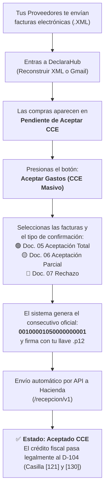

# 🛡️ MANUAL DEL ACEPTADOR MASIVO DE GASTOS (CCE) PARA DUMMIES
### *Cómo blindar tus compras ante Hacienda Costa Rica, deducir el 100% del IVA y evitar multas en 1 clic*

---

## 🧐 1. ¿Por qué existe este módulo y qué problema te resuelve?

En Costa Rica, el Ministerio de Hacienda tiene una trampa legal que la mayoría de los dueños de negocios y contadores descuidados desconocen:

> ⚠️ **La Regla de Oro de Hacienda (Resolución DGT-R-48-2016 y v4.3/v4.4):**  
> Si tú le compraste a un proveedor ₡1,000,000 + ₡130,000 de IVA en repuestos, alquiler, mercadería o servicios, **NO puedes deducirte esos ₡130,000 de IVA ni el gasto en Renta** a menos que le envíes a Hacienda un **Mensaje Receptor (CCE)** firmado digitalmente **antes de los primeros 8 días hábiles del mes siguiente**.

Si no confirmas la factura:
1. Hacienda te quita el derecho al crédito fiscal (te toca pagar ese IVA como si no hubieras gastado nada).
2. Si te hacen una auditoría, te rechazan el gasto y te aplican multas por defraudación o cálculo inexacto.

### 😩 El dolor de cabeza tradicional:
Antes de DeclaraHub, el contador o el dueño del negocio tenía que entrar a la página lenta de **ATV de Hacienda**, subir los archivos XML uno por uno, seleccionar el tipo de aceptación a mano y esperar 5 minutos por factura. ¡Si tenías 40 facturas de gastos, perdías medio día!

### 🚀 La solución con DeclaraHub:
Abres la **Bandeja de Aceptación Masiva**, seleccionas 10, 50 o 100 facturas de golpe, presionas **`TRANSMITIR ACEPTACIÓN A HACIENDA`** y el sistema las firma criptográficamente con tu llave `.p12` y las confirma todas en lote en menos de 10 segundos.

---

## 🚦 2. El Flujo de Trabajo en 1 Diagrama



---

## 🗂️ 3. Los 3 Tipos de Mensajes Receptores Oficiales (05, 06, 07)

Cuando abres la bandeja, tienes 3 opciones para responderle a Hacienda:

```
┌──────────────────────────────┬──────────────────────────────┬──────────────────────────────┐
│  🟢 ACEPTACIÓN TOTAL (05)    │  🟡 ACEPTACIÓN PARCIAL (06)  │   🔴 RECHAZO TOTAL (07)      │
│         [RECOMENDADO]        │                              │                              │
├──────────────────────────────┼──────────────────────────────┼──────────────────────────────┤
│ • Documento oficial: CCE     │ • Documento oficial: CPCE    │ • Documento oficial: RCE     │
│ • Significa: "La factura es  │ • Significa: "Acepto una     │ • Significa: "Esa factura NO │
│   100% correcta y recibí     │   parte, pero me cobraron    │   es mía, me cobraron de más │
│   todo el producto/servicio" │   de más o faltó producto"   │   o es un error del emisor"  │
│ • Consecuencia: Deduces el   │ • Consecuencia: Se deduce    │ • Consecuencia: Se anula     │
│   100% del IVA y del gasto   │   solo el monto acordado     │   para tu contabilidad       │
└──────────────────────────────┴──────────────────────────────┴──────────────────────────────┘
```

---

## 💰 4. ¿Qué es la "Condición de Impuesto" (Acreditación)?

Hacienda te exige que indiques para qué usaste esa compra. DeclaraHub te ofrece un selector intuitivo:

1. **`01 - Genera crédito IVA total (Pleno)`** *(La opción habitual - 95% de los casos)*:
   - Úsala para: insumos de trabajo, shampoo de car wash, navajas de barbería, repuestos de taller, alquiler del local, recibo de luz y agua, compras de mercadería para revender.
   - **Efecto:** Cada colón de IVA que pagaste se resta directamente del IVA que tienes que pagar a fin de mes.

2. **`02 - Genera crédito IVA parcial`**:
   - Úsala cuando el gasto solo se usa a medias para la empresa y a medias para uso personal o para actividades que no cobran el 13%.

3. **`03 - Bienes de capital`**:
   - Úsala para compra de activos fijos grandes: una máquina hidrolavadora industrial, un elevador de carros, computadoras caras o mobiliario.

4. **`04 - Gasto corriente sin derecho a crédito fiscal`**:
   - Úsala cuando la factura es un gasto válido para pagar menos Impuesto sobre la Renta anual, pero la ley no te permite descontar el IVA (por ejemplo, compras vinculadas a ventas exentas).

---

## 📱 5. Paso a Paso con Pantallas: Cómo Aceptar Gastos en 1 Minuto

### Paso 1: Entrar a DeclaraHub
1. En el menú lateral izquierdo, haz clic en **`DeclaraHub (D-104)`**.
2. Verás el botón verde en la cabecera:
   $$\boxed{\mathbf{\text{🛡️ Aceptar Gastos (CCE)}}}$$
   o dentro de la tarjeta de la **Sección II (Crédito Fiscal)**:
   $$\boxed{\mathbf{\text{Aceptar Facturas de Gastos (CCE) } \rightarrow}}$$


---

### Paso 2: Se Abre la Bandeja de Aceptación Masiva
Aparece una ventana profesional con el resumen de tu empresa:

```
┌────────────────────────────────────────────────────────────────────────────────────────┐
│ 🛡️ Aceptador Masivo de Gastos ante Hacienda (CCE)                [Hacienda CR v4.4] [X]│
├────────────────────────────────────────────────────────────────────────────────────────┤
│ 🏢 Empresa: LUXX CAR WASH (3-102-832920)     Total Compras: ₡450,000  IVA: +₡58,500    │
├────────────────────────────────────────────────────────────────────────────────────────┤
│ Acción:  [ 🟢 Aceptación Total (05) ]   [ 🟡 Parcial (06) ]   [ 🔴 Rechazo (07) ]       │
│                                                                                        │
│ Condición IVA: [ 01 - Genera crédito IVA total (Pleno)                              ▼] │
├────────────────────────────────────────────────────────────────────────────────────────┤
│ [✓] Seleccionar todos (12 de 12)                              12 listas para firmar    │
│ ────────────────────────────────────────────────────────────────────────────────────── │
│ [✓]  22/10/2026   KOLBI ICE TELECOMUNICACIONES    50622102600...   ₡35,000   ₡4,550    │
│ [✓]  24/10/2026   DISTRIBUIDORA DE QUIMICOS S.A.  50624102600...  ₡120,000  ₡15,600    │
│ [✓]  28/10/2026   LUBRICANTES CENTRALES LTDA      50628102600...   ₡85,000  ₡11,050    │
├────────────────────────────────────────────────────────────────────────────────────────┤
│ 💡 Genera consecutivo oficial 0010000105000000000X       [Cerrar]  [🚀 TRANSMITIR (12)]│
└────────────────────────────────────────────────────────────────────────────────────────┘
```

---

### Paso 3: Presionar "Transmitir Aceptación a Hacienda"
1. Dejas marcado **`Seleccionar todos`** (o desmarcas alguna factura que no reconozcas).
2. Dejas seleccionada **`Aceptación Total (Doc. 05)`**.
3. Haces clic en el botón verde: **`🚀 TRANSMITIR ACEPTACIÓN A HACIENDA`**.

---

### Paso 4: La Magia de la Firma Digital en Vivo
En pantalla verás una barra de progreso en tiempo real:
```
[████████████████████████████████████░░░░] 75%
Firmando y transmitiendo Mensaje Receptor (9 de 12)...
```
1. El sistema toma cada factura.
2. Arma el archivo XML oficial con el consecutivo de 20 dígitos:
   `001` (Sucursal) + `00001` (Terminal) + `05` (Aceptación) + `0000000009` (Secuencia).
3. Firma el documento con tu llave criptográfica `.p12`.
4. Lo envía por API segura a los servidores del Ministerio de Hacienda.
5. Hacienda responde con código `HTTP 202 Accepted`.

---

### Paso 5: ¡Blindaje Completo!
Al terminar la barra de progreso:
- Aparece una notificación: **"¡Proceso completado! 12 comprobantes confirmados ante Hacienda."**
- En la tabla de comprobantes, el estado cambia automáticamente de `Pendiente` a **`Aceptado CCE ✓`**.
- El simulador de **DeclaraHub D-104** actualiza inmediatamente las **Casillas [121] y [130]**:
  - Tu **Crédito Fiscal** queda 100% legalizado.
  - Tu **Impuesto Neto a Pagar (Casilla [140])** baja de inmediato porque se te restó todo el IVA que tenías a favor.

---

## 🛡️ 6. Preguntas Frecuentes (FAQ)

### ¿Qué pasa si me llega una factura de algo personal que no es del negocio?
En la lista de la bandeja, desmarca esa factura o márcala y cámbiale la acción a **`🔴 Rechazo Total (Doc. 07)`**. Así Hacienda sabe que tú no avalas ese cobro y no te meterás en problemas fiscales.

### ¿Qué pasa si tengo varias empresas (BarberApp, Luxx Car Wash, AvalCar)?
El sistema es **Multi-Tenant estricto**. Solo cambiarás la empresa en el selector superior. La bandeja de confirmación cargará **únicamente las compras de esa empresa** y firmará con la llave `.p12` de esa empresa específica.

### ¿Cuándo es la fecha límite para hacer esto?
Hacienda da tiempo **hasta el día 8 hábil del mes siguiente**. Pero la mejor práctica es:
> **Regla de oro:** Cada vez que importes facturas desde XML o Gmail a fin de mes, presiona **`Aceptar Gastos (CCE Masivo)`** y en 10 segundos tu mes queda blindado legalmente.
