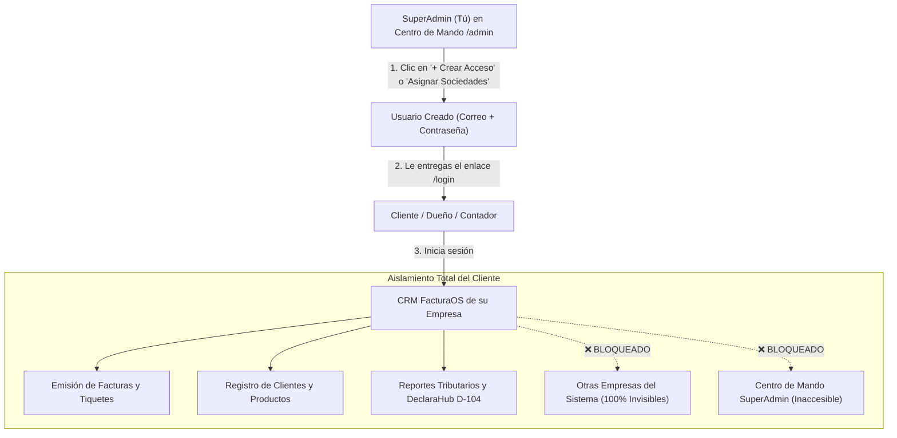

# 📖 MANUAL OPERATIVO: GESTIÓN DE ACCESOS Y CLIENTES EN FACTURAOS (PARA DUMMIES)

> **Dirigido a:** SuperAdministrador de FacturaOS.  
> **Objetivo:** Explicar paso a paso cómo otorgarle usuario y contraseña a un cliente, cómo darle acceso a una o varias empresas, y cómo ingresa el cliente a su propio CRM de facturación.

---

## 🎯 ¿CÓMO FUNCIONA EL MODELO DE ACCESOS EN FACTURAOS?

FacturaOS es una plataforma **SaaS Multi-Empresa con Aislamiento Estricto**. 



---

## 📝 CASO 1: DARLE ACCESO A UN CLIENTE NUEVO A SU EMPRESA (Paso a Paso)

Este es el proceso para cuando das de alta a un cliente (ejemplo: **SRL. 3102832920 - Luxx**) y le vas a entregar sus credenciales de ingreso.

### Paso 1: Ir al Centro de Mando
1. Entra a tu consola de SuperAdmin en:
   ```text
   http://localhost:3000/admin   (o tu dominio https://facturaos.cr/admin)
   ```

### Paso 2: Ubicar la Empresa y Clic en "+ Crear Acceso"
1. En el **Directorio de Empresas**, busca la fila de la empresa (ej: `SRL. 3102832920`).
2. Haz clic en el botón morado: **`+ Crear Acceso`**.

### Paso 3: Llenar el Formulario
Se abrirá la ventana **"Crear Acceso / Usuario"**:
1. **Nombre del Encargado o Puesto:**  
   Escribe el nombre de la persona o el cargo (Ej: `Alexander Gutiérrez` o `Gerencia General`).
2. **Correo Electrónico de Ingreso:**  
   El correo real con el que tu cliente entrará al sistema (Ej: `facturas@grupoluxxcr.com` o el correo personal del dueño).
3. **Contraseña de Acceso:**  
   Escribe una contraseña segura temporal (mínimo 6 caracteres, ej: `Luxx2026*`).
4. **Rol Asignado en la Empresa:**  
   - **Administrador de Empresa (Recomendado para el dueño):** Tiene control total de facturación, clientes, catálogo de productos, gastos y reportes contables de su empresa.
   - **Facturador / Cajero:** Si es solo un empleado que únicamente hace facturas y cobra en caja.
   - **Contador / Auditor:** Acceso de solo lectura para revisar el D-104, gastos y libros contables.

### Paso 4: Clic en "Guardar y Crear Acceso"
- El sistema crea la cuenta de forma segura en Supabase Auth y la vincula de por vida a esa cédula jurídica.
- ¡Listo! La cuenta ya está activa.

---

## 📲 ¿QUÉ DATOS LE ENTREGAS A TU CLIENTE? (Mensaje Listo para Copiar)

Le envías un WhatsApp o correo con este formato:

```text
👋 ¡Hola [Nombre del Cliente]!

Te damos la bienvenida a FacturaOS. Ya tienes habilitado tu sistema oficial de Facturación Electrónica y CRM para tu empresa *[Nombre de la Empresa]*:

🔗 Enlace de Ingreso: https://facturaos.cr/login
📧 Correo: [correo_del_cliente]
🔑 Contraseña temporal: [contraseña_asignada]

Al ingresar tendrás acceso a:
✅ Emisión ilimitada de Facturas Electrónicas y Tiquetes ante Hacienda.
✅ Control de inventario, clientes y productos CabYS.
✅ Buzón automático de gastos y facturas de compras.
✅ Portal del Contador y Cierre Tributario mensual D-104.

Cualquier consulta técnica estamos a tu completa disposición.
```

---

## 🏢 CASO 2: ¿QUÉ PASA SI UN CLIENTE TIENE 2 O MÁS EMPRESAS? (Multisociedades)

Si el mismo dueño o cliente tiene varias cédulas jurídicas (por ejemplo: la sociedad del lubricentro y otra sociedad de alquileres o repuestos):

1. En el Centro de Mando, haz clic en el botón superior: **`Asignar Sociedades a Cliente`** (o clic en la tarjeta **"Usuarios Totales"**).
2. En el menú desplegable, **selecciona el usuario** del cliente.
3. Te aparecerán todas las empresas con casillas de verificación:
   - Marca con un **`✓`** las 2 o 3 empresas que le pertenecen a ese cliente.
   - Haz clic en **`Hacer Principal`** en la empresa que debe cargar por defecto.
4. Clic en **`Guardar Permisos de Sociedades`**.

### ¿Cómo lo experimenta el cliente al ingresar?
- El cliente entra con su mismo correo y contraseña.
- En la barra superior, el nombre de su negocio tendrá una flechita desplegable:
  - Puede pasar de una sociedad a otra con un solo clic.
  - **100% Privado:** Las demás empresas ajenas que usan FacturaOS continúan siendo totalmente invisibles para él.

---

## 🔒 PREGUNTAS FRECUENTES SOBRE SEGURIDAD (FAQ)

### ¿El cliente puede ver el Centro de Mando (`/admin`)?
**No.** Si un cliente intenta entrar manualmente escribiendo `/admin` en su navegador, el sistema detecta que no es SuperAdmin, le bloquea el paso automáticamente y lo redirige a su propio Dashboard.

### ¿El cliente puede ver los datos de otros clientes de FacturaOS?
**Jamás.** Las consultas a la base de datos están filtradas por su `establishment_id` autorizado. Ni clientes, ni productos, ni facturas ajenas se mezclan.

### ¿Qué pasa si el cliente olvida su contraseña?
En la pantalla de inicio de sesión (`/login`), hay un enlace que dice **"¿Olvidaste tu contraseña?"**, donde el cliente ingresa su correo y recibe un enlace para restablecerla por sí mismo. O tú como SuperAdmin puedes asignarle una nueva desde Supabase.
